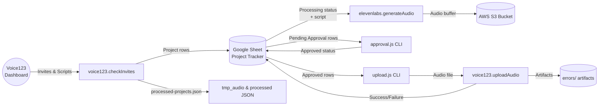
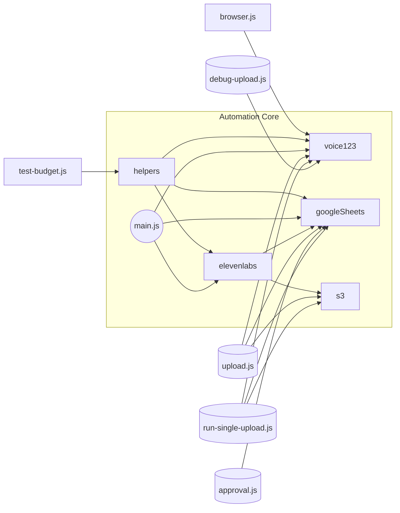

# Voice-Otto Workflow & Data Flow Documentation

This document describes the end-to-end automation that powers the Voice-Otto voiceover pipeline. It captures the overall architecture, how data moves between modules, the key components involved in each stage, and the utilities that support error handling and diagnostics.

---

## 1. High-Level Architecture



At a glance:

1. **Invite ingestion** – `voice123.checkInvites` logs into Voice123 through Browserless, scrapes open projects, validates their scripts, and stores them in both Google Sheets and `processed-projects.json`.
2. **Audio generation** – `elevenlabs.generateAudio` synthesizes audio with ElevenLabs, uploads the file to S3, and marks the Google Sheet entry as `Pending Approval`.
3. **Manual approval** – `approval.js` prompts an operator to approve or reject generated audio, updating the sheet.
4. **Automated upload** – `upload.js` retrieves approved rows, downloads the audio from S3, and runs `voice123.uploadAudio` (a Puppeteer workflow) to submit deliverables back to Voice123.
5. **Diagnostics** – `helpers.js` provides reusable error handling and artifact capture that every stage leverages when something fails.

---

## 2. End-to-End Workflow Stages

### 2.1 Voice123 Login & Invite Scraping (`voice123.checkInvites`)
- **Primary modules:** `browser.js`, `voice123.js`, `helpers.js`, `googleSheets.js`.
- **Flow:**
  1. `browser.connect()` establishes a Puppeteer session against Browserless using `BROWSERLESS_API_KEY`.
  2. `handleLogin(page)` performs multi-step authentication using selectors defined in environment variables.
  3. The dashboard invite list is harvested, producing an array of project metadata (`title`, `url`, `meta`).
  4. Each project page is opened in a separate tab to extract `script`, `description`, `clientId`, and attachment flags via `safeQuerySelector`.
  5. Scripts shorter than 50 characters or projects with attachments are flagged as `Needs Review`; otherwise they are marked `Processing` and the script text is preserved.
  6. `googleSheets.addProject` writes a normalized row to the project tracker, generating a short `projectId` (first 8 chars of a UUID) that becomes the canonical identifier across the workflow.
  7. Collected projects are persisted locally in `processed-projects.json` as a diagnostic snapshot.

### 2.2 Script Validation & Status Tracking (`googleSheets.js`)
- **Responsibilities:**
  - Maintain the single source of truth for project status through Google Sheets.
  - Enforce valid status transitions with `VALID_STATUSES`.
  - Provide helper queries (`getProjectsByStatus`) that downstream scripts use to pull work queues.
- **Data contracts:** Row columns include `Project ID`, `Project Title`, `Project URL`, `Deadline`, `Script`, `Status`, `Processed At`, `Client ID`, `Audio File URL`, and `Voice Settings`.

### 2.3 Text-to-Speech Generation (`elevenlabs.generateAudio`)
- **Inputs:** `projectId`, validated script text.
- **Actions:**
  - Sets the Sheet status to `Processing`.
  - Calls ElevenLabs with per-project text and voice settings controlled through env vars (`ELEVENLABS_*`).
  - Writes a local copy of the audio into `tmp_audio/` when `SAVE_LOCAL_AUDIO` is not `false`.
  - Uploads the resulting buffer to S3 via `s3.uploadFile`, yielding a public URL.
  - Updates the Sheet row to `Pending Approval`, storing both the audio URL and the voice settings snapshot.
- **Error handling:** Any failure records `Status: "Error"` and `Notes` in the Sheet.

### 2.4 Manual QA & Approvals (`approval.js`)
- **Inputs:** Rows from `getProjectsByStatus("Pending Approval")`.
- **Mechanism:** Uses `inquirer` to present an interactive confirmation prompt for each pending project.
- **Outputs:** Updates each row to `Approved` or `Rejected` with timestamped audit info.

### 2.5 Final Upload Back to Voice123 (`upload.js` and `voice123.uploadAudio`)
- **Preparation (`upload.js`):**
  - Pulls approved projects from the Sheet.
  - Downloads audio from S3 into `tmp_audio/`, falling back to direct HTTPS if S3 access fails.
  - Invokes `voice123.uploadAudio(project.url, localFilePath)`.
  - On success, marks the row as `Uploaded`; on failure, records `Upload Failed` with notes.
- **Upload workflow (`voice123.uploadAudio`):**
  - Logs into Voice123 and opens the project proposal page.
  - Ensures the invite is accepted, reveals the upload UI, and validates the local audio file (`validateAudioFile`).
  - Optionally transcodes the file with `ffmpeg` to meet Voice123 constraints (`transcodeAudio`).
  - Attaches the audio via native file inputs or DataTransfer/drag-and-drop fallbacks.
  - Calls `ensureBudgetFields` to populate quote-related fields based on project copy ("zero budget", "looking for a quote").
  - Submits the proposal, waiting for success indicators (DOM selectors, Transloadit responses, or navigation events).
  - Captures diagnostic artifacts on failure using `saveArtifacts`, along with console/network logs.

### 2.6 Diagnostics & Support Utilities
- `helpers.handleError`, `saveArtifacts`, and `retry` provide structured logging, HTML/screenshot capture, and resilient retries.
- Error outputs are written to `errors/` with timestamped bundles (`.png`, `.html`, `.console.log`, `.network.log`).
- `tools/test-budget.js` lets developers replay saved HTML snapshots to harden `ensureBudgetFields` logic.

---

## 3. CLI Entry Points and Support Scripts

| Command | File | Description |
| --- | --- | --- |
| `npm run generate` | `main.js` | Runs full scraping + audio generation pipeline for eligible invites. |
| `npm run approve` | `approval.js` | Prompts operators to approve/reject generated audio. |
| `npm run upload` | `upload.js` | Uploads approved audio back to Voice123 and updates Sheet status. |
| `node run-single-upload.js` | `run-single-upload.js` | Debug helper that uploads only the first approved project. |
| `node debug-upload.js` | `debug-upload.js` | Requires `VOICE123_TEST_URL` and `VOICE123_TEST_AUDIO`; used to iterate on the uploader against a known project. |
| `node pick-approved.js` | `pick-approved.js` | Dumps the first approved Sheet row (useful when wiring integrations). |

Environment validation is run implicitly via `validateEnv.js` in `main.js`, ensuring required secrets (Browserless, Voice123 credentials, ElevenLabs, Google Sheets) are loaded before execution.

---

## 4. Shared Data Model & Storage

### Project Object
Every stage works with a normalized project object shaped like:

```json
{
  "id": "9a3b7c1d",
  "title": "Sample Voice Invite",
  "url": "https://voice123.com/projects/123",
  "deadline": "2 days remaining",
  "script": "Full script text...",
  "description": "Project description...",
  "clientId": "ClientABC",
  "status": "Processing"
}
```

- The `id` originates from Google Sheets (`uuidv4().substring(0, 8)`).
- `status` is synchronized with the Sheet status column; allowable values are constrained by `VALID_STATUSES` in `googleSheets.js`.
- `processed-projects.json` mirrors the latest scrape for offline inspection and regression testing.

### Persistent Stores
- **Google Sheets** – authoritative workflow state and audit history.
- **AWS S3** – final storage for generated audio files (`audio_<projectId>_<timestamp>.mp3`).
- **`tmp_audio/` directory** – local working directory for generated and downloaded audio.
- **`errors/` directory** – structured troubleshooting artifacts, enriched with console + network logs.

---

## 5. Function-Level Data Flow

| Stage | Module & Function | Consumes | Produces / Side Effects |
| --- | --- | --- | --- |
| Validate env | `validateEnv()` | `process.env` | Exits on missing variables. |
| Connect browser | `browser.connect()` | `BROWSERLESS_API_KEY` | Returns Puppeteer `Browser` instance. |
| Scrape invites | `voice123.checkInvites()` | Browser session, Voice123 dashboard | Array of normalized projects, writes `processed-projects.json`, rows in Google Sheet. |
| Save project | `googleSheets.addProject(project)` | Project object | Row in Sheet, generated `projectId`. |
| Generate audio | `elevenlabs.generateAudio(projectId, script)` | Google Sheet link, ElevenLabs API | Audio buffer, S3 upload, Sheet status `Pending Approval`, voice settings JSON. |
| Update status | `googleSheets.updateProject(projectId, updates)` | Sheet row | Mutates row (`Status`, `Notes`, timestamps, `Audio File URL`). |
| Fetch queue | `googleSheets.getProjectsByStatus(status)` | Sheet rows | Array of `{ id, title, url, audioUrl }`. |
| Approval prompt | `approval.js` loop | Pending Approval array | Sheet rows set to `Approved` / `Rejected`. |
| Download audio | `s3.downloadFile(key)` | S3 object key | Local Buffer for upload script. |
| Upload to Voice123 | `voice123.uploadAudio(url, path)` | Voice123 session, local file path | Returns boolean success, triggers Sheet updates via caller. |
| Submit upload | `upload.js` | Approved queue | Sheet rows -> `Uploaded` / `Upload Failed`, cleans temp files. |
| Diagnostics | `helpers.saveArtifacts(page, context, logs)` | Puppeteer page, log buffers | Screenshot/HTML/log files under `errors/`. |

---

## 6. Module Dependency Map



Interpretation:
- `voice123.js` is the largest integration module, consuming `browser.connect`, `helpers`, `googleSheets`, and Node core modules (`fs-extra`, `path`, `child_process`).
- `elevenlabs.js` bridges ElevenLabs, S3, and the Sheet.
- CLI utilities orchestrate combinations of these core modules without duplicating logic.

---

## 7. Component Deep Dive

### Voice123 Automation (`voice123.js`)
- **Scraping:** Handles login (`handleLogin`), invite traversal, script extraction, project validation, and artifact capture when selectors fail.
- **Upload automation:** Contains robust logic for handling upload UI variations, fallbacks for hidden inputs, on-the-fly transcoding with `ffmpeg`, and heuristics to detect successful submissions (DOM success banners, Transloadit responses, or navigation events).
- **Budget helpers:** Delegates to `ensureBudgetFields` to enforce pricing requirements before submit.
- **Resilience:** Uses `waitFor`, `retry`, and extensive logging plus artifact dumps for postmortem analysis.

### Google Sheets Integration (`googleSheets.js`)
- Caches a `GoogleSpreadsheet` instance per run.
- Wraps `addRow`, `updateProject`, and `getRows` calls with retries to mitigate transient network issues.
- Enforces status enums and normalizes column names used across the pipeline.

### ElevenLabs TTS (`elevenlabs.js`)
- Parameterizes voice tuning via environment variables (`ELEVENLABS_STABILITY`, `ELEVENLABS_SPEED`, etc.).
- Stores voice settings alongside each project to aid reproducibility.
- Ensures errors propagate with Sheet annotations to keep operators informed.

### AWS S3 Storage (`s3.js`)
- Uses AWS SDK v3 with environment-based credentials to upload/download audio buffers.
- Returns presigned-style URLs (`https://<bucket>.s3.<region>.amazonaws.com/<key>`) that downstream scripts and human reviewers can access.

### Error Handling & Diagnostics (`helpers.js`)
- Centralizes logging with colorized output (`log` helper).
- Captures screenshots, DOM HTML, console logs, and network traces for any Puppeteer page failure.
- Provides shared utilities (`waitFor`, `retry`, `safeQuerySelector`, `ensureBudgetFields`) to reduce duplicated automation code.

---

## 8. External Services & Configuration

| Service | Purpose | Key Environment Variables |
| --- | --- | --- |
| **Browserless** | Headless Chrome host for Puppeteer | `BROWSERLESS_API_KEY` |
| **Voice123** | Source and destination platform | `VOICE123_EMAIL`, `VOICE123_PASSWORD`, selector overrides (`*_SELECTOR`) |
| **Google Sheets** | Workflow orchestration state | `GOOGLE_SHEET_ID`, `GOOGLE_SERVICE_ACCOUNT_EMAIL`, `GOOGLE_PRIVATE_KEY` |
| **ElevenLabs** | Text-to-speech audio generation | `ELEVENLABS_API_KEY`, `ELEVENLABS_VOICE_ID`, optional tuning vars |
| **AWS S3** | Durable audio storage | `AWS_REGION`, `AWS_BUCKET_NAME`, AWS credential envs |
| **Optional** | Debug upload target | `VOICE123_TEST_URL`, `VOICE123_TEST_AUDIO`, `SAVE_LOCAL_AUDIO` |

Environment enforcement happens via `validateEnv.js` (run automatically in `main.js`) and through on-demand checks in each module.

---

## 9. Operational Notes

- **Sequential processing:** `main.js` iterates projects sequentially to keep logs and status updates deterministic. Parallelization would require Sheet contention handling.
- **Idempotency:** Running `voice123.checkInvites` repeatedly will re-scrape the dashboard but relies on Google Sheets status to prevent duplicate audio generation (only `Processing` rows are synthesized).
- **Cleanup:** Uploader scripts always attempt to delete temporary files after upload; transcoded artifacts are also removed in `finally` blocks.
- **Artifacts:** Keep the `errors/` directory under version control ignore rules (already covered by `.gitignore`). Inspect saved `.json` dumps when upload selectors change on Voice123.
- **Testing helpers:** Use `debug-upload.js` and `tools/test-budget.js` when adjusting selectors or pricing heuristics to avoid hammering production projects.

---

## 10. Summary

The Voice-Otto automation is organized around a Google Sheet that represents the authoritative job queue. Puppeteer-based scraping feeds that sheet, ElevenLabs turns accepted scripts into audio, S3 stores the deliverables, and CLI-driven operators shepherd approvals before the uploader finalizes delivery on Voice123. Centralized helpers provide resilience, error capture, and UI adaptation, making it straightforward to extend or debug individual stages without breaking the overall flow.
